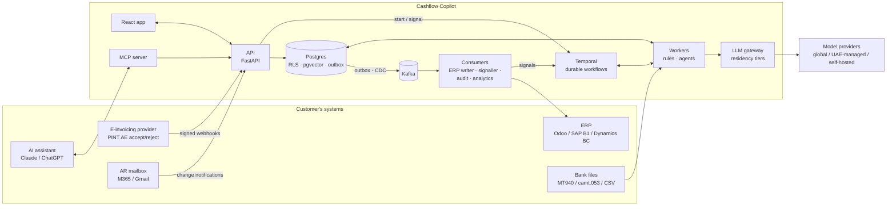
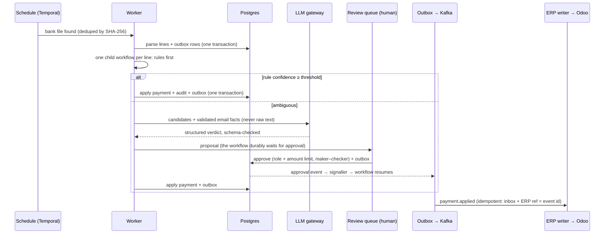

# Cashflow Copilot

**Receivables and cash application for UAE mid-market companies, built for the UAE e-invoicing mandate. AI agents do the first pass; humans approve every action.**

> **About the source code:** Cashflow Copilot is a **commercial product**, intended for distribution through e-invoicing providers and ERP partners, so the source is kept in a **private repository**. This repository covers the architecture and the key engineering decisions. **Code walkthroughs are available on request.**

---

## The problem

A mid-market distributor in the UAE issues hundreds of invoices a month. Cash comes in as bank transfers with references like `PAYMENT` or `INV 0042 + 0063`. Customers dispute deliveries by email, in English and Arabic. And from 2027, every invoice also passes through an e-invoicing provider that can **reject** it, for example over a wrong buyer tax number.

Today an accounts-receivable team handles this by hand:
- **Matching:** bank lines to invoices in Excel.
- **Disputes:** reading emails and digging through contracts.
- **Rejections:** finding out about a rejected e-invoice weeks later, when the customer says "we never received a valid invoice".
- **Reminders:** chasing overdue customers with copy-pasted emails.

Days sales outstanding grows, and cash sits uncollected.

## What it does

| Capability | How |
|---|---|
| **Cash application** | Parses MT940 / camt.053 / CSV bank files. Deterministic rules first (reference, amount, payer, subset-sum over open invoices); an LLM only for the ambiguous remainder. Auto-applies only above an **eval-proven** confidence threshold; everything else goes to a review queue. |
| **E-invoice status** | Listens to the e-invoicing provider's accept/reject messages (PINT AE / Peppol). A rejection opens a task the same day instead of weeks later. |
| **Disputes** | Reads customer emails safely (see *Security*), finds the relevant contract clause and similar past cases, and recommends an outcome **with citations**. A credit note above the analyst's limit needs a controller. |
| **Collections** | Long-running reminder cycles per overdue invoice, with tone set by aging and relationship, in English or Arabic. Every email is approved by a human and sent only to known contacts. |
| **AI-assistant access** | An MCP server lets a CFO ask Claude or ChatGPT "what's overdue for this customer?" with read-only, tenant-scoped, OAuth-protected tools. |

It **integrates with** the customer's ERP (Odoo first; SAP Business One and Dynamics 365 Business Central designed), mailbox (Microsoft 365 / Gmail), CRM (Salesforce, optional) and bank. It does **not** replace any of them.

---

## Architecture

### One payment, end to end

### Runtime

- **One codebase, several processes:** `api`, `mcp`, `worker-workflows`, `worker-agents`, `consumer-*`, `web`.
- **Shared image:** every process is built from the same container image and scaled independently.
  - Workers scale on Temporal queue depth.
  - Consumers scale on consumer lag.

| Environment | Runs on |
|---|---|
| Development | Docker Compose profiles (`core` runs without Kafka or Kubernetes) |
| Primary cloud | AWS me-central-1: EKS, RDS, S3, KMS |
| DR, and install in the customer's own cloud | Azure UAE North: AKS, Postgres Flexible, Blob |
| Deployment | One Helm chart, deployed by ArgoCD (GitOps) and provisioned with Terraform |

---

## The hard problems, and the decisions behind them

Each decision has an ADR with the alternatives considered and the **removal trigger**: the evidence that would make us undo it.

**1. Tenant isolation that survives a developer's mistake.**
- **Setup:** shared database (pool model), with Postgres **row-level security** on every table.
- **How the tenant is set:** `SET LOCAL app.tenant_id` per transaction, taken from the token. It is never taken from the URL or the request body.
- **What makes it hold:** the application's database role has no `BYPASSRLS`.
- **Proof test:** a raw query with no tenant set returns **zero rows**.
- **Lookups before login:** requests that arrive before the tenant is known (logins, webhooks) use narrow `SECURITY DEFINER` functions, not a privileged role.

**2. Money events that are never lost and never duplicated.**
- **Transactional outbox:** the business change and its event row commit in one transaction.
- **Delivery:** Debezium streams the outbox into Kafka. A Postgres poller mode keeps small installs Kafka-free.
- **Idempotent consumers:** an `inbox` table, plus the event ID as the idempotency key in the ERP.
- **Measured, not assumed:** a load test establishes where the poller stops being enough.

**3. Approvals that wait days without anything waiting.**
- **Durable waits:** Temporal workflows wait on signals and durable timers, so a crash, deploy or restart loses nothing.
- **No dual write:** approvals are signalled through the outbox, not called directly. That removes the database-plus-workflow-engine dual write.
- **Disputes as a saga:** a credit note runs as a saga, with the irreversible step (the email) last.

**4. Prompt injection from customer email.**
- **Quarantined extractor:** raw email text only reaches an LLM call with **no tools and no tenant data**. Its output must fit a strict schema.
- **Privileged agents:**
  - they see only validated fields;
  - their tools are read-only;
  - search returns structured past-case fields, never old email text.
- **Human gates:** every action needs a human approval, with per-role, per-action amount limits and maker–checker. Outbound email goes only to allowlisted contacts and is capped per day.
- **Tested in CI:** a red-team suite breaks the build on any successful attack.

**5. Data residency for UAE customers.** All model calls go through one gateway, which routes by the tenant's tier:

| Tier | Providers |
|---|---|
| `global` | Anthropic, OpenAI |
| `uae_managed` | Azure OpenAI UAE North regional deployment, Core42 |
| `uae_selfhosted` | vLLM in a UAE cluster |

- **Never outside the tier:** circuit breakers fall back **only inside the tier**, so an outage never sends a UAE tenant's data abroad.
- **Built in:** metering, budgets, prompt caching and record/replay for deterministic tests.

**6. AI quality as a release gate, not a demo.**
- **Golden sets** for each AI feature: cash matching, disputes, reminders and retrieval (including Arabic queries).
- **CI fails on regression.**
- **Auto-apply threshold:** the lowest score at which precision stays ≥ 0.99 on labelled data.
- **Corrections become test cases:** every human correction in the review queue is added to the eval set.

**7. Boring where boring is right.**
- **A modular monolith, not microservices:** one engineer can operate it, and separate processes still give independent scaling.
- **Postgres for everything relational:** pgvector and full-text search instead of a separate vector database.
- **REST + OpenAPI + SSE instead of GraphQL.**
- **Kafka has to earn its place:** replay, fan-out and the lakehouse. It is optional per deployment.

---

## Stack

| Area | Tools |
|---|---|
| Backend | Python, FastAPI, SQLAlchemy 2 / Alembic, Pydantic v2, uv |
| Data | PostgreSQL (RLS, pgvector, FTS), Redis, S3 / MinIO |
| Workflows and events | Temporal, transactional outbox, Debezium, Kafka (KRaft / Strimzi) |
| AI | Custom LLM gateway, LangGraph (inside Temporal activities), PageIndex for contracts, hybrid retrieval (pgvector + FTS + RRF), MCP server, Langfuse, promptfoo |
| Frontend | React 19, TypeScript, Vite, TanStack Router/Query, Tailwind |
| Auth | OIDC SSO (Microsoft Entra ID, Google), short-lived JWT + rotating refresh tokens, RBAC with amount-based approval limits |
| Platform | Docker, Kubernetes (EKS / AKS / k3d), Helm, ArgoCD, KEDA, Karpenter, Kyverno, Terraform |
| Supply chain | GitHub Actions with OIDC, Trivy, SBOM, cosign |
| Observability | OpenTelemetry → Prometheus, Loki, Tempo, Grafana |
| Analytics | Iceberg, dbt-duckdb |

---

## Design targets

| Target | Value |
|---|---|
| Scale | 50 tenants, 500 concurrent users, ~50K business events/day |
| API latency (non-LLM) | p95 < 300 ms |
| Agent first pass | p95 < 60 s |
| Auto-apply precision | ≥ 0.99 on the labelled eval set |
| Availability | 99.5% SLO, cross-cloud DR (AWS UAE → Azure UAE) |

---

## Data

All demo data is **synthetic**: fictional companies, invoices, bank files, emails and contracts. No real customer data is used anywhere.

## Contact

**Mohamed Sahad**, AI engineer, Dubai.
[LinkedIn](https://www.linkedin.com/in/mohamed-sahad-m/) · [sahadmadathodiyil@gmail.com](mailto:sahadmadathodiyil@gmail.com)

Happy to go deep on any part of the design (tenancy, the event backbone, agent safety, residency routing, the eval methodology) and to walk through the private code live.
